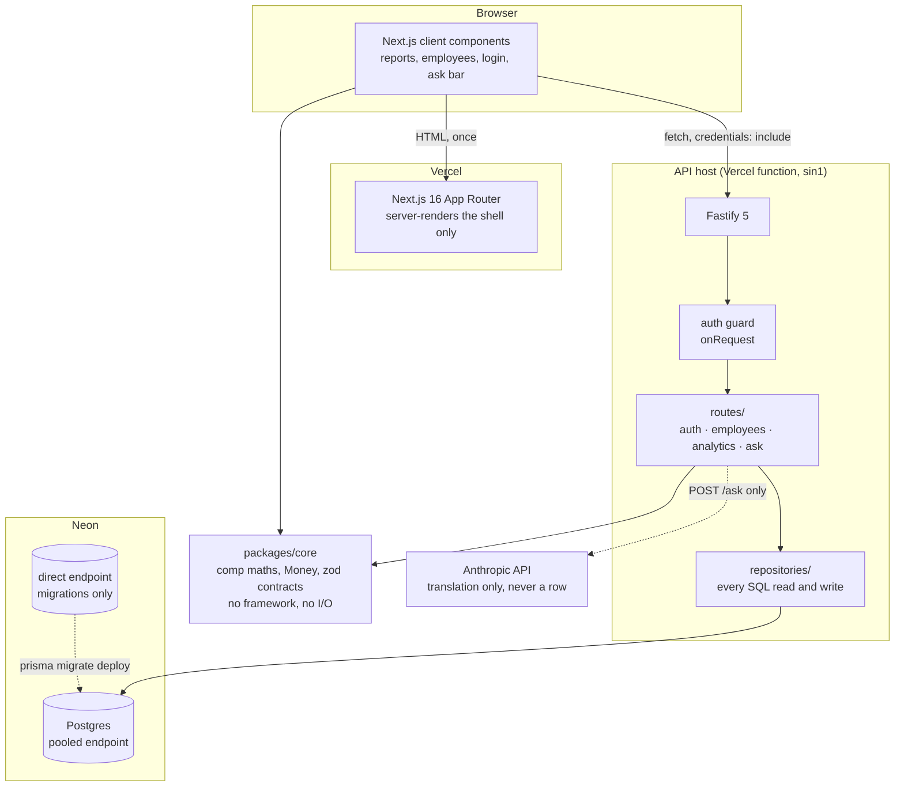
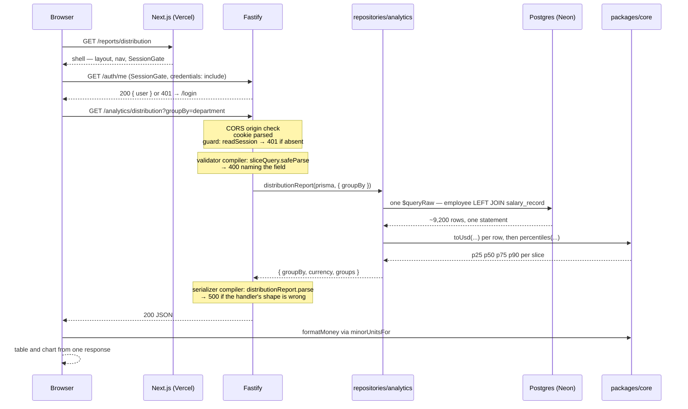
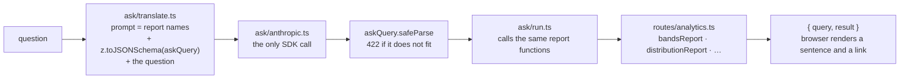

# Architecture

The brief names architecture diagrams. This is them, plus the one request flow worth tracing
end to end. `design-notes.md` decides *what* to build and `decisions/decision-log.md` carries
*why*; this document describes what is actually there, with the file every claim is read from.

## System



Three deployable things and one library. The library is the point: `packages/core` holds every
piece of arithmetic that decides what a number means, and it is reachable from both the server
and the browser because it depends on neither.

| Package | Name | Is | Depends on |
|---|---|---|---|
| `packages/core` | `@paybands/core` | Comp arithmetic, `Money`, the wire and write schemas | nothing in this repo |
| `apps/api` | `@paybands/api` | Fastify 5 over Prisma and Postgres | `@paybands/core` ([`apps/api/package.json:17`](../apps/api/package.json)) |
| `apps/web` | `@paybands/web` | Next.js 16 App Router | `@paybands/core` ([`apps/web/package.json:9`](../apps/web/package.json)) |

`packages/core` is consumed as TypeScript source, not as a build: its `exports` map points at
`./src/index.ts` and there is no emit step ([`packages/core/package.json:6`](../packages/core/package.json)).
The web app compiles it through `transpilePackages: ['@paybands/core']`
([`apps/web/next.config.ts:5`](../apps/web/next.config.ts)); the API compiles it through `tsx` in
development and `tsup` in a build. Decision 12 carries why the project references that would
otherwise be needed were dropped.

## The boundaries, and what holds them

A boundary described in a document is a convention. Three of them here are ESLint rules, which
is the difference between a rule and a hope.

| Boundary | Enforced by | Decision |
|---|---|---|
| `packages/core` imports no framework and no I/O — not `fastify`, `next`, `react`, `@prisma/client`, `node:fs`, `node:net`, `node:http`, `node:https`, `node:child_process` | [`eslint.config.js:48`](../eslint.config.js) | 4 |
| Only `db.ts`, `repositories/`, `seed/` and `testing/` may hold a Prisma value import — every route reaches data through a repository | [`eslint.config.js:82`](../eslint.config.js) | 47 |
| `ask/translate.ts` and `ask/anthropic.ts` may not import a repository or Prisma at all, type imports included | [`eslint.config.js:111`](../eslint.config.js) | 55 |

The third one is the one that matters most and is also the one a lint rule cannot fully
guarantee, which `PB-D09` records: `ask/run.ts` sits deliberately outside it, because executing a
query is exactly the step that has to reach data. The rule covers the translation step, where the
model is, and a database-backed test covers the rest ([`apps/api/src/ask/boundary.db.test.ts`](../apps/api/src/ask/boundary.db.test.ts)).

## apps/api

```
src/
  index.ts        process entry: env, Prisma client, listen
  app.ts          buildApp() — assembles Fastify, never listens, so tests inject()
  db.ts           createPrismaClient(), the only construction site outside seed and tests
  auth/           guard · session · password · rate-limit
  routes/         auth · employees · analytics · ask — declaration and handler body
  repositories/   analytics · employees · reference · users — every query
  ask/            query (schema) · translate (model) · anthropic (SDK) · run (execution)
  seed/           generate · write · reference · rng · names — 10,000 employees, deterministic
  perf/measure.ts the harness behind docs/performance.md
  testing/        db · fixture · global-setup
```

`buildApp` assembles in one order and the order is load-bearing
([`apps/api/src/app.ts:83`](../apps/api/src/app.ts)): the two zod compilers and the error handler
first, then `/health` and `/reference`, then CORS, then the cookie plugin, then the guard, then
the four route modules. The guard is registered inside `app.after()` so it runs behind the cookie
plugin's own hook — a guard that reads a cookie nothing has parsed yet refuses everyone
([`apps/api/src/auth/guard.ts:27`](../apps/api/src/auth/guard.ts)).

Two layers, not three. A route declares its schemas and calls one function; that function reads
through a repository and does its arithmetic in `packages/core`. The five report functions are
exported rather than inlined into their handlers specifically so the ask bar can call the same
ones ([`apps/api/src/routes/analytics.ts:109`](../apps/api/src/routes/analytics.ts), decision 54).

## apps/web

```
app/
  layout.tsx                   root shell — server component, fetches nothing
  page.tsx                     redirect('/employees')
  login/page.tsx               client
  (app)/
    layout.tsx                 server component: <AppNav/> + <SessionGate>
    reports/page.tsx           server component: five links + <AskBar/>
    reports/*/page.tsx         client — bands, distribution, comp-ratio, outliers, pay-gap
    employees/**               client
lib/
  api.ts                       the one fetch wrapper
  use-api.ts                   the one hook, three states
  money.ts                     formatting, through core's minorUnitsFor
```

**Every screen that reads data is a client component, and nothing is fetched on the server.** The
four server components — both layouts, the root page, the reports index — render links and
structure and make no request. `design-notes.md` §6 says *"Server components keep the 10k-row
pages off the client"*, and that is not how it was built: what keeps the 10k rows off the client
is the `limit` cap of 100 on `GET /employees`
([`apps/api/src/routes/employees.ts:64`](../apps/api/src/routes/employees.ts)), so the goal holds
and the mechanism named in the planning note does not. Recorded here rather than quietly
corrected there.

The consequence is worth stating, because it is the whole reason the API's CORS and cookie
configuration look the way they do: the browser talks to the API directly, cross-origin, on every
request. There is no Next.js route handler, no server action and no `app/api/` directory, so
nothing ever forwards the session cookie — the cookie is `HttpOnly` and the browser attaches it
itself, which is why `api.ts` sets `credentials: 'include'`
([`apps/web/lib/api.ts:31`](../apps/web/lib/api.ts)) and why `webOrigin` has to be exact.

## One analytics request, end to end

`GET /analytics/distribution?groupBy=department` — the sliced report, chosen over bands because it
is the one that touches every layer, including the join that phase 11 rewrote.



Hop by hop, with the file:

| # | Where | What |
|---|---|---|
| 1 | [`apps/web/app/(app)/layout.tsx`](../apps/web/app/(app)/layout.tsx) | Server-renders nav and `SessionGate`. No fetch. |
| 2 | [`apps/web/components/session-gate.tsx:14`](../apps/web/components/session-gate.tsx) | Client. Calls `/auth/me`; a 401 redirects to `/login`. |
| 3 | [`apps/web/app/(app)/reports/distribution/page.tsx`](../apps/web/app/(app)/reports/distribution/page.tsx) | Reads `groupBy` from `useSearchParams`, calls `useApi`. |
| 4 | [`apps/web/lib/use-api.ts:21`](../apps/web/lib/use-api.ts) | Three states, not two — loading, error, ready (`PB-059`). |
| 5 | [`apps/web/lib/api.ts:24`](../apps/web/lib/api.ts) | `fetch(BASE + path, { credentials: 'include' })`. `BASE` is `NEXT_PUBLIC_API_URL`, default `http://localhost:3001`. |
| 6 | [`apps/api/src/app.ts:133`](../apps/api/src/app.ts) | CORS decides per request. A stranger's origin gets no header at all, never a wildcard. |
| 7 | [`apps/api/src/auth/guard.ts:27`](../apps/api/src/auth/guard.ts) | `onRequest`, so an unauthenticated request never reaches validation. `{ message: 'Sign in first' }`. |
| 8 | [`apps/api/src/app.ts:88`](../apps/api/src/app.ts) | `sliceQuery.safeParse`. `?groupBy=departmant` is a 400 that names the field, not a filter that did nothing. |
| 9 | [`apps/api/src/routes/analytics.ts:128`](../apps/api/src/routes/analytics.ts) | `distributionReport(prisma, request.query)`. |
| 10 | [`apps/api/src/repositories/analytics.ts:112`](../apps/api/src/repositories/analytics.ts) | `activeWithOpenSalary` — one `$queryRaw` LEFT JOIN. Phase 11 replaced a nested `findMany` here. |
| 11 | [`packages/core/src/fx.ts:24`](../packages/core/src/fx.ts), [`stats.ts:24`](../packages/core/src/stats.ts) | `toUsd` then `percentiles`. Postgres groups and filters; core does the money arithmetic (decision 48). |
| 12 | [`apps/api/src/app.ts:106`](../apps/api/src/app.ts) | Serializer compiler parses on the way out, so a handler cannot return a shape the schema denies. |
| 13 | [`apps/web/lib/money.ts:9`](../apps/web/lib/money.ts) | `formatMoney` through core's `minorUnitsFor`. The chart and the table read the same response. |

### What phase 11 changed at hop 10

Four of the five reports fetch rows; all four used to fetch them as a Prisma nested read, which
compiles to two statements — the second binding every employee id from the first into an `IN`
list. At 9,226 employees that is 9,226 bind parameters, and parse plus bind cost more than the
query. Each became one `$queryRaw` join.

| Report | Before | After |
|---|---|---|
| Distribution | 95 ms | 45 ms |
| Comp ratio | 116 ms | 43 ms |
| Pay gap | 111 ms | 50 ms |
| Outliers | 186 ms | 55 ms |
| Bands | 7 ms | unchanged — its headcount is already a `groupBy` in SQL and 48 rows cross the wire |

No index was added: every plan already used one. `docs/performance.md` has the measurements and
decision 57 the reasoning. The response shapes did not move, which is the containment decision 48
claimed.

## The ask bar



The model is handed three things: the list of report names, the JSON Schema of `askQuery`, and
the question ([`apps/api/src/ask/translate.ts:30`](../apps/api/src/ask/translate.ts)). It is never
handed a row, and what makes that true is a lint rule plus a database-backed test that pulls a
real name and salary out of the seed and asserts neither reaches the prompt. The answer it
produces is a query object, not a number; every number in the response came from the same
deterministic code the report screens call.

Off is the default. `ANTHROPIC_API_KEY` is read once, at the edge, in
[`apps/api/src/index.ts:23`](../apps/api/src/index.ts); empty means `complete: null`, which means
`/health` reports `ask: false`, `POST /ask` answers 503 with the reason, and the bar does not
render at all. Nothing in phases 1–9 imports any of it.

## Deployment

| Variable | Read at | For |
|---|---|---|
| `DATABASE_URL` | [`apps/api/src/db.ts:15`](../apps/api/src/db.ts) | App traffic. The **pooled** Neon endpoint. |
| `DIRECT_URL` | [`apps/api/prisma.config.ts:15`](../apps/api/prisma.config.ts) | Migrations only. The **direct** endpoint — advisory locks and the shadow database need it (decision 20). |
| `SESSION_SECRET` | [`apps/api/src/index.ts:14`](../apps/api/src/index.ts) | Signs the session cookie. Under 32 characters the process refuses to start. |
| `WEB_ORIGIN` | `index.ts:30` | The one origin CORS allows. Default `http://localhost:3000`. |
| `ANTHROPIC_API_KEY` | `index.ts:23` | The ask bar. Empty or unset is off. |
| `TRUST_PROXY` | `index.ts:31` | Whether `X-Forwarded-For` decides `request.ip`, and therefore what both rate limiters count by. Unset is off, which is correct only for a server reached directly (decision 51, `PB-078`). |
| `PORT` / `HOST` | `index.ts:11` | Default `3001` / `0.0.0.0`. |
| `NEXT_PUBLIC_API_URL` | [`apps/web/lib/api.ts:7`](../apps/web/lib/api.ts) | The browser's API base. Default `http://localhost:3001`. |

`docker-compose.yml` is the **test** database and nothing else: one `postgres:17-alpine` on host
port 5433, data on `tmpfs`, named `paybands_test`. Local development runs against Neon; the
container exists so the integration suite has a database it is allowed to truncate (decision 44).

CI is one job ([`.github/workflows/ci.yml`](../.github/workflows/ci.yml)): install, `typecheck`,
`lint`, `test`, `build`, with a Postgres 17 service container and `TEST_DATABASE_URL` set at the
job level — so the database tests that skip themselves on a laptop cannot skip in CI.

## Tests

Three vitest projects ([`vitest.config.ts`](../vitest.config.ts)):

| Project | Root | Matches | Database |
|---|---|---|---|
| `core` | `packages/core` | `src/**/*.test.ts` | never — pure functions |
| `api` | `apps/api` | `src/**/*.test.ts` minus `*.db.test.ts` | never |
| `api-db` | `apps/api` | `src/**/*.db.test.ts` | required; `fileParallelism: false` |

The suffix is the whole convention. A `.db.test.ts` file wraps its `describe` in
`describe.skipIf(!hasTestDatabase())`, and
[`apps/api/src/testing/global-setup.ts:11`](../apps/api/src/testing/global-setup.ts) returns
quietly when `TEST_DATABASE_URL` is unset — unless `CI` is set, where it throws instead. Skipping
is a laptop affordance, not a CI one. `resetAndSeed` refuses any database whose name does not end
in `_test`.

There is no committed browser suite. The one Playwright smoke that `design-notes.md` §6 lists is
not in the repository; the ask bar and the five report screens were driven through a real browser
by hand during phases 9 and 10, and `docs/ai-usage.md` records that. `PB-D12` is the debt ticket
this document opened for it.
