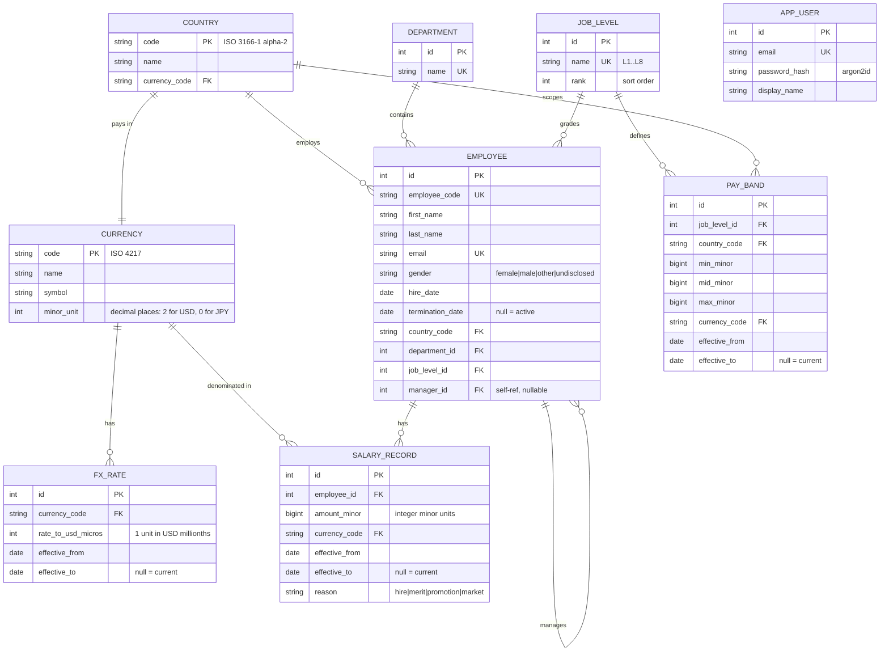

# Data model

Effective dating, currency and band scoping are decided here, and every report reads through them. This is the canonical description; `design-notes.md` links here.

## ER diagram



`APP_USER` has no link to `EMPLOYEE`. Joining the login identity to the dataset it administers raises "can she see her own row differently" — a question there is no role system to answer.

## The four calls

Everything else is ordinary. These four are the decisions.

### 1. Money is integer minor units

`amount_minor BIGINT` plus a `currency_code`. ₹1,250,000.00 is `125000000` / `INR`. Never a float, never a decimal string.

Every report divides — comp ratio by a midpoint, range penetration by a band width, percentiles between two values. Binary floating point cannot represent 0.1, and chained division compounds the error. A figure that is a cent off destroys trust in every number on the page.

`BIGINT` has room: the largest realistic salary here is ~10^10 minor units against a 9.2 × 10^18 ceiling.

FX rates get the same treatment — `rate_to_usd_micros`, an integer of millionths. Conversion is `amount_minor × rate_micros / 1_000_000`, divided once at a documented rounding point rather than accumulating across a sum.

> Costs: raw rows are harder to read in a SQL client, and a `Money` type is needed to stop bare integers leaking around. Postgres `NUMERIC` is exact too, but reaches JavaScript as a string or a lossy number and needs the same wrapper.

### 2. Effective dating, with `NULL` for "current"

`salary_record`, `pay_band` and `fx_rate` carry `effective_from` / `effective_to`. `NULL` means still in force.

No `is_current` flag: a flag and a date range can disagree, and nothing in the database says which one is wrong. With dates alone, "the row in force on date X" is one predicate everywhere:

```sql
WHERE effective_from <= $date
  AND (effective_to IS NULL OR effective_to > $date)
```

Ranges are half-open. A raise on 1 April sets the old row's `effective_to` and the new row's `effective_from` to the same date — no gap, no overlap, no argument about who owns the boundary day. Both writes go in one transaction; a half-success would leave an employee with two current salaries or none.

The database enforces the invariant rather than trusting the application:

```sql
CREATE UNIQUE INDEX one_open_salary_per_employee
  ON salary_record (employee_id) WHERE effective_to IS NULL;
```

> Costs: every read path grows a date predicate, and "what is this person paid" becomes a query. Contained by using the same predicate everywhere, and keeping the UI surface to a timeline on the detail page.

### 3. Pay bands are scoped to level **and** country

`(job_level, country) → (min, mid, max)`, in that country's currency.

A band spanning countries is the FX problem relocated: an L4 band of $80k–$120k says nothing useful about an L4 in India. Converting the band at today's rate makes everyone's comp ratio move when the exchange rate moves — which is false, since nobody's pay position changed.

So comp ratio and range penetration are computed in local currency against the local band. USD conversion is used only for cross-country *salary* comparison in the distribution report.

> Costs: the seed generates `levels × countries` bands (8 × 6 = 48) instead of 8. Cheap, and the right kind of work.

### 4. `gender` is a non-null enum with an explicit `undisclosed`

Four values — `female`, `male`, `other`, `undisclosed`. Not nullable, not free text.

`NULL` lets an employee silently vanish from a headcount, the worst failure available in a report whose purpose is counting people fairly. An explicit value forces every consumer to decide what to do with it, and the gap report decides visibly: `undisclosed` and `other` count toward headcount, are excluded from the two-group comparison, and the excluded count goes in the response.

> Costs: adding a fifth value is a migration. Free text would avoid that and make the report ungroupable.

## Indexes

Added with the schema, not after a slow query is noticed.

| Index | Serves |
|---|---|
| `salary_record (employee_id, effective_from)` | Salary timeline, current-record lookup |
| `salary_record (employee_id) WHERE effective_to IS NULL` — unique, partial | The one-open-record invariant, and current-salary joins |
| `employee (country_code, department_id, job_level_id)` | Every analytics group-by and the list filters |
| `employee (termination_date)` | Active-employee filtering, which every report applies |
| `pay_band (job_level_id, country_code)` | Band lookup per employee |
| `fx_rate (currency_code, effective_from)` | Rate lookup on a date |

Whether these are the right indexes is a measurement, not an opinion. Phase 11 runs `EXPLAIN ANALYZE` against the full seed and records before/after in `performance.md`.

## Scale

10,000 employees × 3–5 salary records is 30–50k rows. Row count is not the constraint; the analytics queries are. The employee list paginates rather than shipping 10,000 rows to a browser.

## Related

- [`glossary.md`](glossary.md) — comp ratio, range penetration, the two gap measures
- [`decisions/decision-log.md`](decisions/decision-log.md) — decisions 1, 5, 9, 10 and 11 argue these calls against their cheaper alternatives
