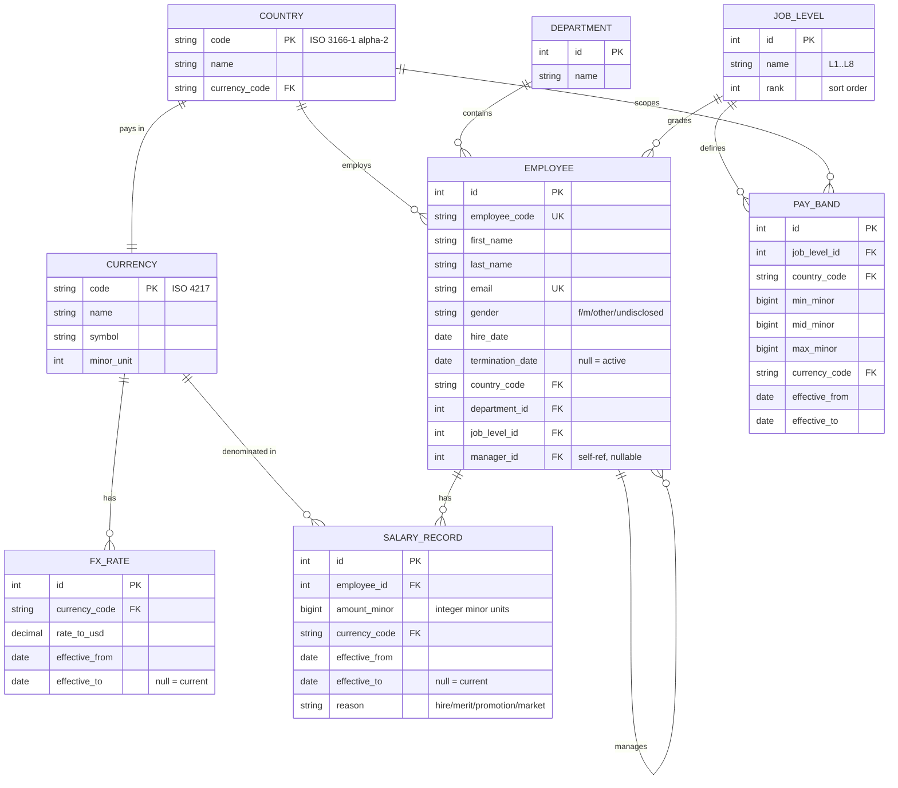

# Incubyte Assessment — Salary Management

Planning doc for the take-home. Source brief: `incubyte-assessment.docx` ("Salary Management Assessment — Candidates", 3 pages).

Role applied for: Software Craftsperson — Node / React / TypeScript (II/III). The brief says backend language should match the role applied for, so this is a Node + TypeScript build.

---

## 1. What the brief asks for

| | |
|---|---|
| Goal | Employee salary management software, 10,000 employees, multiple countries |
| Persona | HR Manager at ACME. Currently runs everything in Excel. |
| Core ask | Manage salary data in a web app, and answer questions about how the org pays people |
| Backend | Language/framework matching the applied role. Relational DB, SQLite acceptable. |
| UI | React or Next.js, component library of choice |
| Seeding | Seed script producing 10,000 employees |
| Readiness | Deployed and working. Video demo. |
| Tests | Meaningful unit tests on core logic. Fast, deterministic, readable. |
| Process | Incremental commits showing how the solution evolved |
| Pre-work | One-page requirements doc written **before** building, stating scope and what is deliberately left out, with reasoning |
| Submission | Git repo link, replying to the original email |

Grading line worth re-reading: *"We are not looking for the most complex system, but for good engineering judgment."* Scope discipline is being marked. Cutting the right things and saying why is part of the deliverable, not a shortcut.

---

## 2. Interpretation of "answer questions about how the org pays people"

Decided: **analytics and reporting UI**, not natural-language querying.

Reasoning: the persona is an HR manager replacing spreadsheets. What she cannot do in Excel at 10,000 rows is slice, compare, and spot outliers quickly. An LLM query box would be a flashier demo but a worse product answer, and it would put the interesting engineering in a prompt instead of in the data model. The brief also warns against complexity for its own sake.

Reports in scope:

- **Pay bands** per job level and country — min, midpoint, max, and where each employee sits in the range
- **Comp ratio** — salary ÷ band midpoint, distributed across the org and per slice
- **Distribution** by country, department, and level — headcount, p25 / p50 / p75 / p90, mean
- **Outliers** — paid below band minimum, above band maximum, or comp ratio outside a configurable threshold
- **Gender pay gap** — mean and median gap, overall and per department/level, with small-sample suppression

Small-sample suppression matters: a "gender pay gap" computed over three people in a department is noise presented as a finding. Groups under a minimum headcount get suppressed rather than displayed. This is the kind of thing an HR manager would otherwise get wrong in Excel, so it belongs in the product.

---

## 3. Scope decisions

### 3.1 Multi-currency and FX

**In scope.** Salaries are stored in the employee's local currency, with a normalized USD figure for cross-country comparison.

The brief says "multiple countries". Comparing a salary in INR against one in GBP without normalizing produces meaningless pay bands and a meaningless pay gap number, so normalization is not optional once countries are in the data.

FX rates come from a seeded, effective-dated rate table — not a live API. A live feed would add a network dependency, make tests nondeterministic, and change nothing about the analysis quality. Each salary row keeps its original `amount` + `currency_code`; USD is derived through the rate table.

> Ceiling: static seeded rate table. If real-time accuracy ever mattered, swap the rate source behind the same lookup interface.

### 3.2 Salary history vs. current-only

**In scope — salary records are effective-dated.** "Current salary" is derived (the record whose effective range covers today), not a column on the employee.

None of the five reports strictly need history, so this is the one place the plan spends complexity ahead of immediate need. The reason is asymmetry of cost: adding effective dating later means rewriting the schema, the seed script, and every analytics query. Adding it now costs one table and a date predicate. For salary data specifically — where "what did we pay her before the promotion" is a question any HR manager eventually asks — current-only is a one-way door.

The complexity is held to the data model. The UI surface stays small: a salary timeline on the employee detail page, nothing more. No point-in-time reporting, no "as of" filter across the analytics pages.

### 3.3 Auth and roles

**Authentication: yes. Role system: no.**

The app gets deployed to a public URL, and salary data for 10,000 people is the most sensitive dataset a company holds. Shipping it behind an unauthenticated link would be an engineering-judgment failure regardless of how good the rest is. So: session-based login, hashed passwords, protected API routes, seeded HR-manager account.

But there is exactly one persona in the brief. A roles table, a permissions matrix, and per-route authorization checks would all be serving a second user type that does not exist. One authenticated role, no RBAC.

> Ceiling: single role. An employee-facing or manager-facing view would need real authorization; the route guard is the place that changes.

---

## 4. Data model (first cut)



Notes on the model:

- **Money is stored as integer minor units**, never floats. Comp ratio and percentile maths on floating-point currency drifts, and salary figures that are off by a cent in a report destroy trust in the whole tool.
- **`gender` is nullable with an explicit "undisclosed" value.** Real HR data has gaps; the pay gap report has to handle employees with no recorded gender rather than silently dropping them.
- **Pay bands are per level *and* country**, because a band that spans countries is just the FX problem again in a different place.
- **Effective-dated rows use a null `effective_to` for "current"** rather than a separate flag, so "the record covering date X" is one predicate and there is no flag to get out of sync.
- Indexes to add with the schema: `salary_record(employee_id, effective_from)`, `employee(country_code, department_id, job_level_id)`, `pay_band(job_level_id, country_code)`.

### Scale note

10,000 employees with roughly 3–5 salary records each is 30–50k rows. SQLite handles this without effort; the analytics queries are the thing to watch, not the row count. Percentiles and group-bys get measured with the full seeded dataset, and the API paginates employee lists rather than returning 10,000 rows to the browser.

---

## 5. Artifacts to commit

The brief names six. This list keeps those and adds the ones the brief implies but does not spell out.

### Named in the brief

| Artifact | File | Note |
|---|---|---|
| Requirements document | `docs/requirements.md` | One page. Written and committed **before** the first implementation commit — the commit order is itself evidence. |
| Planning / design notes | `docs/design-notes.md` | This document becomes the seed of it |
| Architecture diagrams | `docs/architecture.md` | System diagram + request flow for one analytics query |
| AI prompts / instructions | `docs/ai-usage.md` | Prompts used, plus where AI output was rejected and why |
| Trade-off explanations | `docs/decisions/` | Short ADRs, one per real decision |
| Performance considerations | `docs/performance.md` | Query plans and timings against the full 10k seed |

### Added

| Artifact | File | Why it belongs |
|---|---|---|
| **ER diagram** | `docs/data-model.md` | The schema is the centre of this problem — effective dating, currency, band scoping. A reviewer should be able to judge the design without reading a migration file. |
| README | `README.md` | Clone → seed → run → test → deployed URL. If a reviewer cannot run it in two minutes, nothing else in the repo gets read. |
| API contract | `docs/api.md` or OpenAPI | Makes the backend reviewable independently of the UI |
| Test strategy | `docs/testing.md` | What is unit tested vs. integration tested, and why the analytics maths gets the heaviest coverage |
| Seed data design | `docs/seed-design.md` | How 10,000 realistic employees are generated — distributions, salary spread, deliberate outliers planted so the outlier report has something true to find |
| Glossary | `docs/glossary.md` | Comp ratio, range penetration, band midpoint, median vs. mean gap. Defined once, so the UI and the code use the same words. |
| Non-goals | section of `requirements.md` | The brief explicitly asks what is left out and why |
| Security & data handling note | `docs/security.md` | Salary data is sensitive and the app is publicly deployed. Covers auth, password hashing, what is not logged. |
| Demo | `docs/demo.md` + video link | Short script plus the recording |

Not planned: a changelog, contribution guide, or issue templates. Nobody else is contributing to this repo and the commit history already tells the story.

---

## 6. Deliberate non-goals

Each of these gets one line of reasoning in `requirements.md`:

- Payroll processing, payslips, tax, statutory deductions — this is a *comp analysis* tool, not a payroll engine
- Bonus, equity, and total-rewards modelling — triples the data model for a second-order question
- Approval workflows for salary changes — needs a second role, and there is one persona
- Bulk Excel import/export — the brief frames Excel as the problem being replaced
- Audit log of salary edits — genuinely needed in a real HR system; cut here as a scope call, noted as the first thing to add
- Natural-language querying — see §2
- Multi-tenancy, i18n, notifications, mobile app

---

## 7. Proposed stack

The role is full-stack: *"4+ years of experience in ReactJS, Node, TypeScript, LLMs and PostgreSQL"*. The stack is chosen to match that list literally rather than to be clever.

| Layer | Choice | Reasoning |
|---|---|---|
| Backend | Node 22 + TypeScript + Fastify 5 | The JD names Node. A standalone API service makes the backend visible and reviewable on its own; Next.js route handlers would technically be Node while hiding the backend inside the frontend. Fastify over Express for first-class TS types and schema validation at the route boundary. |
| DB | PostgreSQL (Neon) via Prisma | The JD names PostgreSQL. The brief says "relational database of your choice, like SQLite" — SQLite is permitted, not required. Postgres also removes the persistent-volume problem that SQLite creates on every free host. |
| UI | Next.js 15 App Router + React 19 + TypeScript | Named in the brief. Server components keep the 10k-row pages off the client. |
| Components | shadcn/ui + Tailwind | Owned source, no black-box component library to fight |
| Charts | Recharts | Distribution and band charts are the only charting need |
| Shared | `packages/core` — pure comp maths + domain types | Framework-free, no I/O. Testable without a database, HTTP, or React, and the web app consumes the same types the API returns. |
| Tests | Vitest + Testing Library + one Playwright smoke | Fast and deterministic, which the brief asks for by name. Playwright is named in the JD. |
| CI | GitHub Actions — typecheck, lint, test, build | The JD describes developers owning the release cycle. A red build visible in the repo is cheap and says more than a paragraph about CI. |
| Deploy | Vercel (web) + Render or Fly (API) + Neon (DB) | Public URL, free tier, reproducible |

Repo layout:

```
paybands/
├─ apps/api          Fastify + TypeScript
├─ apps/web          Next.js
├─ packages/core     comp maths, pure, zero framework imports
└─ docs/
```

---

## 8. The LLM question

The JD lists LLMs among the required skills, and the brief's phrasing — *"answer questions about how the org pays people"* — can be read as natural-language querying. §2 settled the product answer: the reports are the product. That does not change.

**Decided: one bounded LLM feature, built last, behind a flag.** An "ask bar" above the reports that turns a typed question into a *query*, never into an answer.

The boundary is the whole point:

| | |
|---|---|
| The model does | translate English into a structured query object — metric, group-by, filters, date |
| The model never does | compute a number, read a salary row, see a name, or produce displayed text |
| Validation | the query object is zod-parsed. Anything that does not fit the schema is rejected, not retried into submission. |
| Execution | the validated query runs the **same** deterministic analytics functions the report pages call |
| Tests | the model boundary is mocked; the translator is tested against fixed inputs, so the suite stays fast and deterministic |
| Without an API key | the feature is off and everything else works. The deployed demo does not depend on it. |

Why it is worth the phase: it demonstrates the JD's LLM requirement while making the stronger engineering statement — that a language model is not allowed anywhere near money arithmetic. A system where the LLM computes comp ratios is a worse system, and saying so with working code is better than saying so in an interview.

Why it is last and flagged: if the schedule tightens, phase 10 deletes cleanly. Nothing in phases 1–9 imports it.

> Ceiling: single-turn translation, no conversation memory, no tool loop. A follow-up question re-translates from scratch.

---

## 9. Quality gates

Three skills run as gates rather than as an afterthought, and their output becomes repo artifacts:

| Skill | When | Produces |
|---|---|---|
| `decision-critic` | continuously, at each decision | `docs/decisions/decision-log.md` → the trade-off artifact the brief asks for |
| `attack-surface-audit` | before deploy | `docs/security.md` — secrets, auth, database, input, exposure, each PASS/FAIL with file:line |
| `legal-exposure-audit` | before deploy | privacy section of `docs/security.md`. Salary plus gender is personal data; a product holding it should say how it handles it. |

The decision log is the useful one. Writing trade-offs down while deciding produces something true; reconstructing them the night before submission produces something plausible.

---

## 10. Questions for Incubyte

Short list, worth one email. The brief invites questions and says fast submissions get prioritised, so these go out now and the build starts in parallel under the assumptions above.

1. **Deadline.** The email says "least possible time" but gives no date. Is there an actual cut-off?
2. **"Answer questions about how the org pays people"** — confirming this means analytics and reporting views (§2), not a natural-language/LLM query interface.
3. **Multi-currency.** Confirming that "multiple countries" means salaries in local currencies needing normalization for comparison, rather than one reporting currency throughout.
4. **Salary history.** Is effective-dated salary history expected, or is current salary per employee sufficient? Planning to build history for the reason in §3.2, but happy to cut it if the intent was current-only.
5. **Auth.** Is any authentication expected for a single-persona tool, or is an open demo URL acceptable? Planning single-user login because the deployment is public and the data is salary data.
6. **Gender pay gap reporting.** This needs a gender field in the seeded data. Confirming that is acceptable and in the spirit of the exercise.

Every one of these has a stated default, so none of them block starting.

---

## 11. Build order

Commit history is graded, so the sequence is the point, not just the endpoint. Phase-by-phase checklist: [`tasks/todo.md`](tasks/todo.md).

Shape of it: docs → workspace + CI → schema → seed → comp maths (test-first) → API → auth → UI → reports → optional ask bar → performance → audits → deploy.

Two sequencing choices are deliberate:

- **Docs commit before any product code.** The brief asks for a requirements document written before building. Commit order is the only way to actually show that.
- **The comp maths is built test-first, one function per pair of commits.** The JD opens with "Write Tests First". A history where tests appear after the implementation says the opposite.
